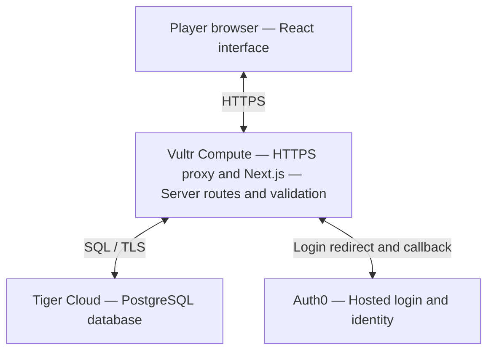

# Campus Pickleball Website

*Idea scope specifications and design architecture*

Prepared for Paul Hong  |  HackPSU Fall 2026  |  Proposed MVP v1

## 1  Product direction

Build a mobile friendly website that helps university players find people at a similar self-reported skill level and commit to a time and court. The first release should let a player sign in, create a profile, find or host a session, and see who has joined. The planning target is one developer working with Codex for five hours; this is a scope estimate, not a completion guarantee.

### Problem and intended users

Players may want to play without messaging friends individually or arriving at empty courts. The initial audience is Penn State and nearby players. The data model supports more universities, but the demo uses one campus and a short, manually curated court list. Campus affiliation is self-declared and does not imply university verification.

### Core product decision

Match people through open play sessions. A host posts a court, time, format, and accepted skill levels; other players claim available spots. Skill is an editable profile choice: Beginner, Intermediate, or Advanced. These are app labels, not official ratings. DUPR integration, competitive rankings, and automatic skill calculation are excluded.

| Priority | Included scope |
| --- | --- |
| Must have | Auth0 sign-in; profile; find games; create session; join and leave; participant list; host cancellation; My Games. |
| Should have | Mobile layout; date, court, and skill filters; clear empty, loading, full, and error states. |
| Optional after core | Voluntary court check-ins, activity history, and a small Tiger Data analytics view. |
| Later | Chat, notifications, recurring sessions, waitlists, university SSO, maps, moderation tools, and region distance search. |

### Definition of a successful first release

Two people on separate devices can sign in, create profiles, find the same game, and join it. Refreshing either device shows the saved participant list. The app prevents duplicate membership and overbooking. No score logging is needed for this release.

## 2  Screens and behavior

| Screen | Required behavior |
| --- | --- |
| Find Games | Campus selector defaulting to Penn State; upcoming session cards; date, court, and skill filters; include full games toggle. |
| Sign In and Profile | Auth0 hosted login; display name, university, and required skill choice; save profile before hosting or joining. |
| Create Game | Court, local start time, duration, singles or doubles, accepted skill levels, and optional short notes. |
| Game Details | Host, court, start and end time, skill range, participant names, spots remaining, and Join or Leave action. |
| My Games | Upcoming hosted and joined sessions; open details; host can cancel; past and cancelled games shown separately. |

### Primary journey

Find Games → Sign In → Complete Profile → Filter for a suitable game → Open Details → Join → View in My Games. If no suitable game exists, offer Create Game with the selected campus and skill prefilled.

### Skill matching specification

- Beginner: learning rules and basic control. Intermediate: can sustain rallies and play regular games. Advanced: comfortable with placement, pace, and strategy. Show these descriptions during setup.
- The host selects one or more adjacent levels, such as Beginner through Intermediate. Default discovery uses the player’s level; players may browse other levels, but joining requires a level within the session range.
- Use simple SQL filters and chronological sorting. No AI model or recommendation service is required. Profile changes affect future joins; existing memberships remain valid.

### Session rules

- Singles has 2 spots and doubles has 4; the host occupies one spot automatically. This MVP schedules one playing group per session, not a large open-play event.
- Start time must be in the future; duration must be 30–180 minutes. Notes are plain text with a 300 character limit. Store UTC timestamps and display court local time.
- A player can join once, leave before the start, and rejoin if eligible and space remains. Joining closes at the start time; overlapping commitments are blocked.
- Only the host can cancel. A host who wants to leave must cancel the session; host transfer and session editing are deferred. Full is derived from participant count, not a separate status.

A session organizes players; it does not reserve a physical court. Display this beside the court and start time. Scheduled participants and voluntary check-ins must be labeled separately.

## 3  Recommended architecture

Use one Next.js application with React, TypeScript, and Tailwind for the interface and server routes. Host it on a Vultr Compute VM, connect server-side to Tiger Cloud PostgreSQL, and use Auth0 for authentication. This avoids maintaining a separate frontend and backend service during the hackathon. These are proposed design choices, not integrations already implemented.

The browser reaches Auth0 through the login redirect. All application database access stays behind server routes. The diagram groups UI delivery and server logic into one deployed app.

### How a request moves through the system

Auth0 completes login and the Next.js SDK establishes the application session. On first use, the server maps the authenticated subject to a profile. A Join request reads identity from that trusted session, validates skill and time rules, then writes membership in a database transaction. The interface refreshes from the saved result. [2]

### Deployment boundary

Use one VM running the Node application under a process manager or container, with an HTTPS reverse proxy such as Caddy. Keep Tiger Cloud external rather than running a second database on the VM. Configure the public HTTPS hostname and Auth0 callback and logout allowlists early. A domain or working HTTPS hostname is a deployment prerequisite. Vultr documents Next.js hosting; its Supabase components are unnecessary for this design. [3]

Use ordinary refreshes after mutations and optional 15 second polling while a details page is open. WebSockets, Kubernetes, GPUs, and microservices add no required value to this MVP.

## 4  Data model and server contract

Use UUID primary keys, foreign keys, and parameterized SQL through the Node PostgreSQL driver. Keep schema migrations in the repository. All core entities are ordinary PostgreSQL tables; only the optional activity stream uses a hypertable. [1]

| Entity | Key fields and relationships |
| --- | --- |
| universities | id, name, region. One university has many courts and profiles. |
| profiles | id, auth_subject UNIQUE, display_name, university_id FK, skill_level CHECK 1–3, created_at, updated_at. Never store passwords. |
| courts | id, university_id FK, name, address, timezone. Seed a short curated list; no court management screen. |
| sessions | id, host_id FK, court_id FK, starts_at, ends_at, format, skill_min, skill_max, status scheduled or cancelled, notes, created_at. |
| session_members | session_id FK, profile_id FK, joined_at; composite primary key on session_id and profile_id. Host is also a member. |
| court_checkins optional | profile_id primary key, court_id FK, checked_in_at, expires_at. One current location per player; server enforces expiry. |
| activity_events optional | occurred_at, event_id, court_id, event_type, optional profile_id. Append-only hypertable partitioned by occurred_at; any unique key includes this partition key. |

### Preventing overbooking and conflicting joins

For join and leave operations, lock the acting profile row, then the session row in a consistent order. While holding those locks, check scheduled status, start time, skill eligibility, overlapping joined sessions, and member count; then insert or delete membership. Create also locks the host profile and checks overlap. Cancel locks the session. Every membership write follows this protocol so two requests cannot claim the final spot or create overlapping commitments.

| Route | Purpose |
| --- | --- |
| GET /api/courts and GET /api/sessions | Read court list and filtered games; support campus, date, court, and level; paginate results. |
| GET /api/sessions/:id | Read details, participants, current status, and available spots. |
| GET and PUT /api/me | Read or update the authenticated profile; auth subject comes from the session. |
| POST /api/sessions | Create a scheduled session and host membership atomically. |
| POST /api/sessions/:id/join | Join as the authenticated player; reject full, closed, overlapping, or ineligible games. |
| DELETE /api/sessions/:id/membership | Leave the current player’s membership; host must cancel instead. |
| POST /api/sessions/:id/cancel | Host only; mark cancelled and retain memberships for history. |
| GET /api/me/games | Read the current player’s hosted and joined sessions. |

Return 401 for missing authentication, 403 for forbidden actions, 404 for missing records, 409 for membership or capacity conflicts, and 400 for invalid input. A repeated join returns the existing membership without adding a second spot.

## 5  Sponsor fit and implementation limits

### Tiger Data as the single database

Tiger Cloud stores profiles, sessions, and memberships using PostgreSQL. This is a natural core integration even if analytics is postponed. Hypertables can coexist with relational tables, enabling a later time-stamped activity stream without introducing a second datastore. [1]

Optional demonstration: add an I Am Here button for a selected court. Each check-in lasts 60 minutes and can be ended early. Show the number of distinct unexpired check-ins and when the display last refreshed. This is reported player presence, not measured occupancy or available court capacity.

Keep current check-ins in a regular table and append check-in and checkout events to a hypertable. A small chart can show check-in events by court and hour. If time permits, use a continuous aggregate to precompute historical hourly event counts. Do not use event totals as the live presence count; use current unexpired check-ins. Continuous aggregates need a refresh policy and a visible freshness label. [4]

This gives Tiger Data a useful time-series role, but a small demo does not justify claims of massive scale, measured speedups, or compression savings. Label any generated activity as sample data. Analytics is the first feature to cut if the core flow is unfinished.

### Vultr as the application host

Run the real web application on Vultr Compute and demonstrate its public URL from a second device. The app server talks to Tiger Cloud and Auth0; no GPU or additional database is needed. Confirm account readiness, credits, and the selected instance cost before provisioning. The prize text does not establish credit eligibility or guarantee zero cost. [3]

### Auth0 as the identity provider

Use Auth0 Universal Login with one basic sign-in method and the official Next.js SDK. The app stores profile and membership data; Auth0 handles credentials and authentication. App routes still enforce ownership and participation rules. A signed-in account does not prove student status. MFA, university federation, and extra identity providers are deferred. [2]

### Security and reliability requirements

- Keep database credentials and Auth0 secrets server-side in environment variables, outside git. Use HTTPS, database TLS, SDK-managed cookies, and origin or CSRF checks for mutations.
- Derive acting identity from the authenticated session. Never trust a submitted profile ID as the current user. Validate every write on the server and escape displayed notes.
- Require sign-in for participant names; expose only display name and skill level. Do not expose email, precise GPS, or Auth0 subjects in participant responses.
- Disable repeated submit clicks, show actionable errors, and preserve form input after failure. A failed write must not appear as a successful join.

Sponsor capabilities were checked against official documentation on October 24, 2026. Award eligibility, current offers, and judging criteria require confirmation with the organizers; using a service is not a promise of qualification.

## 6  Build plan and acceptance checks

| Elapsed time | Deliverable |
| --- | --- |
| 0–30 minutes | Create repository and app; verify Auth0 account, Tiger Cloud connection, Vultr access, and HTTPS deployment path. Start a deployment immediately. |
| 30–75 minutes | Apply schema and seed campus and courts. Implement Auth0 callback, protected routes, and profile setup. |
| 75–150 minutes | Implement session creation, listing, details, joins, leaves, cancellation, and My Games. Finish one full journey before styling. |
| 150–210 minutes | Add skill and date filters, responsive layouts, capacity transactions, validation, and empty or error states. |
| 210–255 minutes | Test on deployed HTTPS site with two accounts and devices. Fix identity, persistence, permission, and concurrency issues. |
| 255–300 minutes | Use remaining time for optional check-ins only if core checks pass. Freeze features, prepare demo, document setup and limitations. |

### Acceptance criteria

- A new player signs in, saves a self-reported level, and returns to the same profile after logout and login.
- Host creates an Intermediate doubles session; one spot is occupied and three remain. A second eligible account joins and sees the same saved roster after refresh.
- Joining twice consumes one spot. Two concurrent requests for the final spot produce exactly one new member; the other receives a clear full-game response.
- A player outside the accepted range, an overlapping participant, or a user joining after start is rejected. A non-host cannot cancel. Leaving reopens a spot.
- Host cancellation disables joining and appears in My Games. An unauthenticated direct API write fails. Main actions work on a phone sized screen.

### Fallback and demo sequence

If sponsor setup stalls, continue core implementation against local PostgreSQL and the same schema; do not claim a Tiger Data integration until connected. If public hosting is blocked, deliver a local demo and identify deployment as incomplete. Do not replace Auth0 with rushed custom password handling. Cut check-ins, analytics, and visual extras before cutting the create and join journey.

Demo: sign in as a host → create a game → sign in on another device → find by skill → join → show updated roster → leave or cancel. If optional analytics works, show reported presence separately and explain the historical chart with its actual or sample data label.

### Official references

[1] Tiger Data PostgreSQL and time series capabilities  
<https://www.tigerdata.com/timescaledb>

[2] Auth0 Next.js authentication quickstart  
<https://auth0.com/docs/quickstart/webapp/nextjs>

[3] Vultr Next.js hosting example using its Supabase Marketplace app  
<https://docs.vultr.com/how-to-deploy-a-nextjs-application-with-vultr-supabase-marketplace-app>

[4] Tiger Data continuous aggregates  
<https://www.tigerdata.com/docs/use-timescale/latest/continuous-aggregates/about-continuous-aggregates/>
